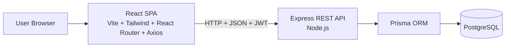
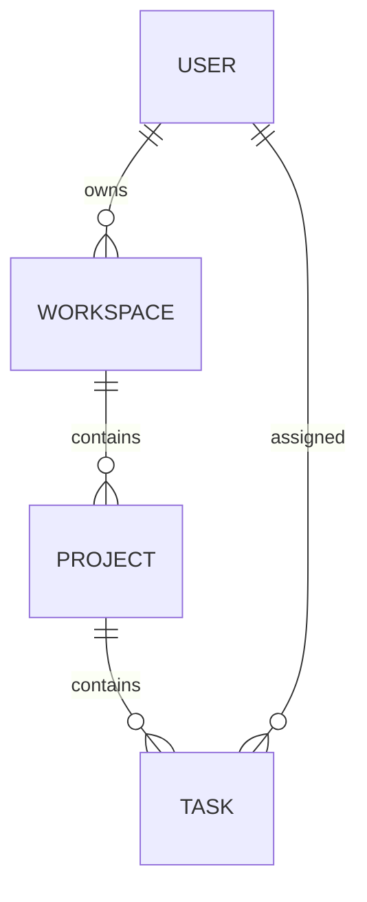

# 02 — Architecture

> **Purpose:** The single source of truth for **how** TaskFlow is built.
> Covers tech stack, system design, folder structure, data model, API design,
> and key technical decisions — along with the reasoning behind them.
> This document is **approved** (2026-08-02). It must never contradict
> [01_PROJECT_REQUIREMENTS.md](./01_PROJECT_REQUIREMENTS.md) / `PROJECT_REQUIREMENTS.md`.

## Table of Contents

1. [Architecture Overview](#1-architecture-overview)
2. [Tech Stack](#2-tech-stack)
3. [System Design](#3-system-design)
4. [Monorepo / Folder Structure](#4-monorepo--folder-structure)
5. [Data Model](#5-data-model)
6. [API Design](#6-api-design)
7. [Authentication Flow](#7-authentication-flow)
8. [Key Technical Decisions](#8-key-technical-decisions)
9. [Scalability Path (v2.0)](#9-scalability-path-v20)
10. [Development Setup](#10-development-setup)

---

## 1. Architecture Overview

TaskFlow is a **full-stack web application** with a clear three-layer split:

- **Frontend:** A single-page application (SPA) built with React.
- **Backend:** A REST API built with Express.
- **Database:** PostgreSQL, accessed only through the Prisma ORM.



Data flows one way: browser → API → ORM → database. The frontend never touches
the database directly.

## 2. Tech Stack

| Layer          | Technology     | Why it was chosen                                                        |
| -------------- | -------------- | ------------------------------------------------------------------------ |
| UI             | React          | Component-based, industry standard, huge ecosystem, easy to learn.       |
| Build tool     | Vite           | Fast dev server and builds; the modern default for React apps.           |
| Language       | JavaScript     | Simpler than TypeScript for v1.0; no extra compile/type setup.           |
| Styling        | Tailwind CSS   | Utility-first classes → fast, consistent UI with no CSS files to manage. |
| Routing        | React Router   | Standard routing for SPAs; protected routes for auth.                    |
| HTTP client    | Axios          | Simple promise-based client; interceptors for attaching the JWT.         |
| Backend        | Node.js        | Same language as frontend — one language across the stack.               |
| Backend        | Express.js     | Minimal, battle-tested REST framework; easy to structure.                |
| Database       | PostgreSQL     | Production-grade relational DB; robust, free, interview-friendly.        |
| ORM            | Prisma         | Readable schema, auto-generated migrations, safe queries.                |
| Authentication | JWT            | Stateless tokens; standard modern approach for SPAs.                     |
| Password hash  | bcrypt         | Industry-standard, secure password hashing.                              |
| Version control| Git + GitHub   | Standard workflow, backup, and portfolio visibility.                     |

## 3. System Design

- **SPA + REST:** `client/` (React SPA) and `server/` (Express API) are separate
  applications communicating over HTTP with JSON.
- **State management:** React state + Context API. No heavy state library in v1.0
  (keeps it simple; easy to add later if needed).
- **Auth model:** JWT is sent with each API request in the `Authorization` header.
  The backend protects all routes except login/register; the frontend guards its routes.
- **CORS:** Enabled in development so the frontend (e.g., `localhost:5173`) can
  call the API (e.g., `localhost:3000`).
- **Error handling:** Backend returns consistent JSON error responses
  (`{ error: { code, message } }`); frontend surfaces them in the UI.

## 4. Monorepo / Folder Structure

```
Taskflow/
├── client/        # React SPA (Vite) — frontend
│   └── src/
│       ├── assets/      # Static assets (images, icons)
│       ├── components/  # Reusable UI components
│       ├── layouts/     # Page layout wrappers
│       ├── pages/       # Route-level page components
│       ├── routes/      # Route definitions + route guards
│       ├── services/    # API calls (Axios)
│       ├── utils/       # Helper functions
│       ├── App.jsx      # App root
│       ├── main.jsx     # Entry point
│       └── index.css    # Global styles (Tailwind entry)
├── server/        # Express API (Node.js) — backend
├── docs/          # Project documentation — single source of truth
└── README.md      # Project overview + setup guide
```

- ✅ Frontend scaffolded in `client/` (Vite 8 + React 19, JavaScript).
- TODO: `server/` inner layout and `prisma/` schema location — added when backend setup starts.
- TODO: Vite dev proxy to the API — added when the backend exists.

## 5. Data Model

Entities (from requirements FR-06 to FR-26):

- **User** — `id`, `name`, `email` (unique), `passwordHash`, `createdAt`, `updatedAt`.
  Owns workspaces.
- **Workspace** — `id`, `name`, `ownerId → User`, timestamps. Has projects.
- **Project** — `id`, `name`, `description`, `workspaceId → Workspace`, timestamps.
  Has tasks.
- **Task** — `id`, `title`, `description`, `status` (To Do | In Progress | Done),
  `priority`, `assigneeId → User`, `dueDate`, `projectId → Project`, timestamps.



- TODO: Confirm exact column types (e.g., `status`/`priority` as enum vs string)
  when the Prisma schema is written.

## 6. API Design

REST API under `/api`, JSON responses, JWT-protected except auth endpoints.

| Method | Endpoint                                          | Purpose                          |
| ------ | ------------------------------------------------- | -------------------------------- |
| POST   | `/api/auth/register`                              | Create account, return JWT       |
| POST   | `/api/auth/login`                                 | Log in, return JWT               |
| GET    | `/api/workspaces`                                 | List user's workspaces           |
| POST   | `/api/workspaces`                                 | Create workspace                 |
| GET    | `/api/workspaces/:id`                             | Workspace detail                 |
| PATCH  | `/api/workspaces/:id`                             | Rename workspace                 |
| DELETE | `/api/workspaces/:id`                             | Delete workspace                 |
| GET    | `/api/workspaces/:id/projects`                    | List projects in workspace       |
| POST   | `/api/workspaces/:id/projects`                    | Create project                   |
| PATCH  | `/api/projects/:id`                               | Edit project                     |
| DELETE | `/api/projects/:id`                               | Delete project                   |
| GET    | `/api/projects/:id/tasks`                         | List tasks in project            |
| POST   | `/api/projects/:id/tasks`                         | Create task                      |
| PATCH  | `/api/tasks/:id`                                  | Edit task / change status        |
| DELETE | `/api/tasks/:id`                                  | Delete task                      |
| GET    | `/api/me`                                         | Current user profile             |
| PATCH  | `/api/me`                                         | Update profile / change password |

- TODO: Request/response examples per endpoint will be added before backend coding.

## 7. Authentication Flow

1. **Register:** client sends `name`, `email`, `password` → server hashes the
   password with **bcrypt** → stores user → returns JWT.
2. **Login:** client sends `email`, `password` → server verifies with **bcrypt** →
   returns JWT.
3. **Authorized requests:** client attaches the JWT via the `Authorization` header
   (Axios interceptor) → backend middleware verifies it before allowing the route.
4. **Logout:** client discards the token (server stays stateless).
5. **Frontend guards:** unauthenticated users are redirected to the login page.

- TODO: Decide token storage (localStorage vs httpOnly cookie) before the auth phase.

## 8. Key Technical Decisions

| # | Decision             | Alternatives considered | Why chosen                                        |
| - | -------------------- | ----------------------- | ------------------------------------------------- |
| 1 | JavaScript over TS   | TypeScript              | Beginner-friendly, no type/build complexity in v1.0 |
| 2 | Tailwind CSS         | Plain CSS, CSS modules  | Fast, consistent utility-first styling            |
| 3 | PostgreSQL + Prisma  | SQLite, MongoDB, raw SQL| Production-grade DB; readable schema + migrations |
| 4 | JWT + bcrypt         | Sessions, other hashers | Stateless auth; industry standard                 |
| 5 | Separate client/server | Single codebase       | Clear separation of concerns; scales to v2.0      |
| 6 | react-router@7.18.2 (pinned) | React Router v8, react-router-dom | v8 needs Node ≥ 22.22 (we have 22.18); v8 dropped `react-router-dom`; 7.18.2 is the latest 7.x and leaves 1 advisory that only affects unstable RSC APIs (unused in our SPA). Upgrade to v8 planned once Node is upgraded. |

- TODO: Record any new decision here (and in [06_PROJECT_MEMORY.md](./06_PROJECT_MEMORY.md))
  the moment it is made. Never document invented decisions.

## 9. Scalability Path (v2.0)

- v2.0 features ([01_PROJECT_REQUIREMENTS.md](./01_PROJECT_REQUIREMENTS.md) §7) map
  cleanly onto this architecture:
  - Team invitations/roles → new `WorkspaceMember` tables.
  - Comments/activity → new `TaskComment`, `Activity` tables.
  - Real-time updates → WebSockets on the same Express server.
- The Prisma schema will be designed so new models can be added via migrations
  without rewriting existing code.

## 10. Development Setup

### Frontend (client/)

1. `cd client`
2. `npm install`
3. `npm run dev` → app runs at `http://localhost:5173`
4. `npm run build` → production build to `dist/`
5. `npm run lint` → lint check (oxlint)

### Backend (server/)

- TODO: Steps once the backend is scaffolded (Express, Prisma, PostgreSQL).

### Environment notes

- Node.js v22.18.0 (installed). React Router v8 requires Node ≥ 22.22 — noted as a
  future upgrade path (see §8, decision 6).

---

*Status: Approved — 2026-08-02. Tech stack is final and matches PROJECT_REQUIREMENTS.md.*
