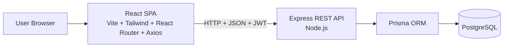
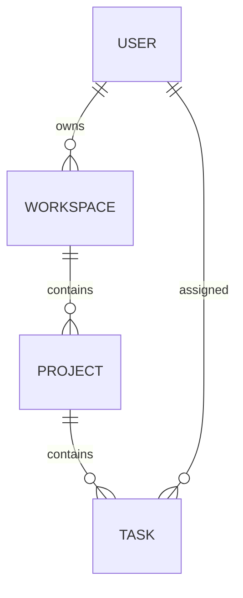

# 02 — Architecture

> **Purpose:** The single source of truth for **how** TaskFlow is built.
> Covers tech stack, system design, folder structure, data model, API design,
> and key technical decisions — along with the reasoning behind them.
> This document is **approved** (2026-08-02). It must never contradict
> [01_PROJECT_REQUIREMENTS.md](./01_PROJECT_REQUIREMENTS.md) / `PROJECT_REQUIREMENTS.md`.

## Table of Contents

1. [Architecture Overview](#1-architecture-overview)
2. [Tech Stack](#2-tech-stack)
3. [System Design](#3-system-design)
4. [Monorepo / Folder Structure](#4-monorepo--folder-structure)
5. [Data Model](#5-data-model)
6. [API Design](#6-api-design)
7. [Authentication Flow](#7-authentication-flow)
8. [Key Technical Decisions](#8-key-technical-decisions)
9. [Scalability Path (v2.0)](#9-scalability-path-v20)
10. [Development Setup](#10-development-setup)

---

## 1. Architecture Overview

TaskFlow is a **full-stack web application** with a clear three-layer split:

- **Frontend:** A single-page application (SPA) built with React.
- **Backend:** A REST API built with Express.
- **Database:** PostgreSQL, accessed only through the Prisma ORM.



Data flows one way: browser → API → ORM → database. The frontend never touches
the database directly.

## 2. Tech Stack

| Layer          | Technology     | Why it was chosen                                                        |
| -------------- | -------------- | ------------------------------------------------------------------------ |
| UI             | React          | Component-based, industry standard, huge ecosystem, easy to learn.       |
| Build tool     | Vite           | Fast dev server and builds; the modern default for React apps.           |
| Language       | JavaScript     | Simpler than TypeScript for v1.0; no extra compile/type setup.           |
| Styling        | Tailwind CSS   | Utility-first classes → fast, consistent UI with no CSS files to manage. |
| Routing        | React Router   | Standard routing for SPAs; protected routes for auth.                    |
| HTTP client    | Axios          | Simple promise-based client; interceptors for attaching the JWT.         |
| Backend        | Node.js        | Same language as frontend — one language across the stack.               |
| Backend        | Express.js     | Minimal, battle-tested REST framework; easy to structure.                |
| Database       | PostgreSQL     | Production-grade relational DB; robust, free, interview-friendly.        |
| ORM            | Prisma         | Readable schema, auto-generated migrations, safe queries.                |
| Authentication | JWT            | Stateless tokens; standard modern approach for SPAs.                     |
| Password hash  | bcrypt         | Industry-standard, secure password hashing.                              |
| Version control| Git + GitHub   | Standard workflow, backup, and portfolio visibility.                     |

## 3. System Design

- **SPA + REST:** `client/` (React SPA) and `server/` (Express API) are separate
  applications communicating over HTTP with JSON.
- **State management:** React state + Context API. No heavy state library in v1.0
  (keeps it simple; easy to add later if needed).
- **Auth model:** JWT is sent with each API request in the `Authorization` header.
  The backend protects all routes except login/register; the frontend guards its routes.
- **CORS:** Enabled only for the configured client origin (`CLIENT_ORIGIN`,
  default `http://localhost:5173`) so the React SPA can call the API on
  `localhost:3000` — never `*`.
- **Error handling:** Backend returns consistent JSON error responses
  (`{ error: { code, message, details? } }`) from the central handler in
  `src/middleware/`; frontend surfaces them in the UI.

## 4. Monorepo / Folder Structure

```
Taskflow/
├── client/        # React SPA (Vite) — frontend
│   └── src/
│       ├── assets/      # Static assets (images, icons)
│       ├── components/  # Reusable UI components
│       ├── context/     # Auth provider + useAuth hook (Phase 11.3)
│       ├── layouts/     # Page layout wrappers
│       ├── pages/       # Route-level page components
│       ├── routes/      # Route definitions + route guards
│       ├── services/    # Axios client + API calls
│       ├── utils/       # Helper functions
│       ├── App.jsx      # App root
│       ├── main.jsx     # Entry point
│       └── index.css    # Global styles (Tailwind entry)
├── server/        # Express API (Node.js) — backend
│   ├── prisma/
│   │   ├── schema.prisma      # Data model (single source of truth)
│   │   └── migrations/        # Committed SQL migration history
│   ├── src/
│   │   ├── db/                # Lazy shared Prisma client + DB smoke test
│   │   ├── middleware/        # 404, auth, + central error handler
│   │   ├── routes/            # Routers (health, auth, me, workspaces, projects, tasks)
│   │   ├── utils/             # Errors, validation, ownership, selects, bcrypt, JWT
│   │   ├── app.js             # Express app wiring (exported for tests)
│   │   └── server.js          # Entry point — imports app + listens
│   ├── tests/                 # Integration tests (isolated taskflow_test DB)
│   ├── prisma.config.js       # Prisma CLI config (schema, migrations, datasource)
│   ├── .env.example           # Documented env template (copy to .env)
│   └── package.json           # Server package (ESM, npm scripts)
├── docs/          # Project documentation — single source of truth
└── README.md      # Project overview + setup guide
```

- ✅ Frontend scaffolded in `client/` (Vite 8 + React 19, JavaScript).
- ✅ Backend scaffolded in `server/` (Express, ESM, Node 22) — Phase 9.1: entry
  `src/server.js` + `src/routes/` (starting with `health.js`). Folders are
  created only when they contain their first real file.
- ✅ Phase 9.2: `src/middleware/` (`notFound.js` + `errorHandler.js`), `.env` /
  `.env.example` (dotenv), and CORS restricted to `CLIENT_ORIGIN`.
- ✅ Phase 10: `prisma/schema.prisma` + committed migrations, `prisma.config.js`,
  and `src/db/` (`prisma.js` shared client + read-only `check.js`); PostgreSQL
  database `taskflow_dev` connected through Prisma 7.10.1.
- ✅ Phase 11.1: `src/routes/auth.js` + `src/routes/me.js`,
  `src/middleware/requireAuth.js`, and `src/utils/` (AppError, validation,
  password, JWT, safe selects); bcrypt + jsonwebtoken installed; lazy
  `getPrisma()` keeps `/api/health` database-independent.
- ✅ Phase 11.2: owner-scoped workspace/project/task CRUD in
  `src/routes/workspaces.js`, `projects.js`, and `tasks.js`; ownership helpers,
  response selects, `app.js`/`server.js` split, and guarded integration tests in
  `server/tests/crud.test.js` against isolated `taskflow_test`.
- ✅ Phase 11.3: frontend API/auth foundation — Axios instance + Bearer
  interceptor, auth API calls, `AuthProvider`/`useAuth`, `taskflow_token`
  storage, startup `/api/me` session check, real login/register flows,
  auth-aware guards, personalized header/greeting, and the Vite `/api` proxy.
  Dashboard and Kanban data remain mock.
- ✅ Phase 11.4: API-backed workspace/project management on the Projects page —
  workspace/project services, local selection state, inline create/rename/delete
  forms, cascade warnings, and client-side name/description validation.
  Dashboard and Kanban remained mock; no backend or schema changes.
- ✅ Phase 11.5: API-backed Tasks/Kanban — task services, URL-backed workspace/
  project selection, real create/edit/delete, server-confirmed status moves,
  loading/error/retry states, and real model fields only. The Dashboard remained
  mock in that subphase; no backend or schema changes.
- ✅ Phase 11.6: API-backed Dashboard and Settings — profile/password endpoints,
  conditional current-password checks, client-side dashboard aggregation over the
  existing workspace/project/task APIs, real project/task cards, and a guarded
  demo seed script. No schema, migration, or dependency changes.

## 5. Data Model

Implemented in Phase 10 in `server/prisma/schema.prisma` and migration
`20261022145549_init` (from requirements FR-06 to FR-26):

- **User** — `id` (auto-increment), `name`, `email` (unique), `passwordHash`,
  `createdAt`, `updatedAt`. Owns workspaces and can be assigned tasks.
- **Workspace** — `id`, `name`, `ownerId → User`, timestamps. Has projects.
- **Project** — `id`, `name`, optional `description`, `workspaceId → Workspace`,
  timestamps. Has tasks.
- **Task** — `id`, `title`, optional `description`, `status` (`TaskStatus` enum:
  `TODO | IN_PROGRESS | DONE`), `priority` (`TaskPriority` enum:
  `LOW | MEDIUM | HIGH`), optional `dueDate`, optional `assigneeId → User`,
  `projectId → Project`, timestamps.



Database rules:

- `Workspace.ownerId` → `User.id`: `ON DELETE RESTRICT` (owners with workspaces
  cannot be deleted accidentally).
- `Project.workspaceId` → `Workspace.id`: `ON DELETE CASCADE`.
- `Task.projectId` → `Project.id`: `ON DELETE CASCADE`.
- `Task.assigneeId` → `User.id`: `ON DELETE SET NULL` (the task survives and
  becomes unassigned).
- Indexes: `Workspace.ownerId`, `Project.workspaceId`, `Task.projectId`,
  `Task.assigneeId`, `Task.status`; `User.email` is uniquely indexed.
- Prisma creates an internal `_prisma_migrations` table to track applied
  migrations; it is not an application table.

## 6. API Design

REST API under `/api`, JSON responses, JWT-protected except the health and auth
endpoints. Phase 11.1 implements the auth foundation; Phase 11.2 implements
workspace/project/task CRUD; Phase 11.4 consumes workspace/project CRUD in the
Projects UI; Phase 11.5 consumes task CRUD in the Tasks/Kanban UI; Phase 11.6.5
adds the read-only Calendar date-range API.

| Method | Endpoint                                          | Purpose                          |
| ------ | ------------------------------------------------- | -------------------------------- |
| POST   | `/api/auth/register`                              | Create account, return JWT       |
| POST   | `/api/auth/login`                                 | Log in, return JWT               |
| GET    | `/api/workspaces`                                 | List user's workspaces           |
| POST   | `/api/workspaces`                                 | Create workspace                 |
| GET    | `/api/workspaces/:workspaceId`                    | Workspace detail                 |
| PATCH  | `/api/workspaces/:workspaceId`                    | Rename workspace                 |
| DELETE | `/api/workspaces/:workspaceId`                    | Delete workspace                 |
| GET    | `/api/workspaces/:workspaceId/projects`           | List projects in workspace       |
| POST   | `/api/workspaces/:workspaceId/projects`           | Create project                   |
| PATCH  | `/api/projects/:projectId`                        | Edit project                     |
| DELETE | `/api/projects/:projectId`                        | Delete project                   |
| GET    | `/api/projects/:projectId/tasks`                  | List tasks in project            |
| POST   | `/api/projects/:projectId/tasks`                  | Create task                      |
| PATCH  | `/api/tasks/:taskId`                              | Edit task / change status        |
| DELETE | `/api/tasks/:taskId`                              | Delete task                      |
| GET    | `/api/tasks?from=YYYY-MM-DD&to=YYYY-MM-DD`        | Calendar tasks in date range     |
| GET    | `/api/me`                                         | Current user profile             |
| PATCH  | `/api/me`                                         | Update name / email              |
| PATCH  | `/api/me/password`                                | Change password                  |

- **Implemented in Phase 11.1:** `POST /api/auth/register`,
  `POST /api/auth/login`, `GET /api/me`.
- **Implemented in Phase 11.2:** workspace, project, and task CRUD as listed
  above.
- **Implemented in Phase 11.3:** Vite `/api` proxy, Axios client with Bearer
  interceptor, login/register API calls, `/api/me` session bootstrap, auth
  context, and auth-aware guards.
- **Implemented in Phase 11.4:** API-backed workspace/project UI.
- **Implemented in Phase 11.5:** API-backed task UI and Kanban status
  persistence.
- **Implemented in Phase 11.6:** `PATCH /api/me`, `PATCH /api/me/password`,
  API-backed Dashboard, Settings UI, and the guarded demo seed script.
- **Implemented in Phase 11.6.5:** the owner-scoped Calendar date-range API in
  §6.7 and the read-only Calendar UI. Phase 11.7 and later remain unapproved.
- **Remaining Phase 11 API work:** none — Phase 11.7 requires separate approval.

### 6.1 Implemented auth contract (Phase 11.1)

- Success envelope: `{ "data": ... }`. Error envelope:
  `{ "error": { "code": "...", "message": "...", "details": [...]? } }`.
- `POST /api/auth/register` — body `{ name, email, password }` → `201`
  `{ data: { token, user } }`. Validation errors `400 VALIDATION_ERROR` (with
  field details), duplicate normalized email `409 EMAIL_IN_USE`.
- `POST /api/auth/login` — body `{ email, password }` → `200`
  `{ data: { token, user } }`; invalid credentials `401 INVALID_CREDENTIALS`.
- `GET /api/me` — requires `Authorization: Bearer <token>` → `200`
  `{ data: user }`; missing, invalid, or expired token `401 UNAUTHORIZED`.
- `user` always uses the safe shape in `utils/selects.js` (`id`, `name`, `email`,
  `createdAt`, `updatedAt`) — never `passwordHash`.
- JWT: HS256, payload `{ "sub": "<userId>" }`, default expiry `7d`
  (`JWT_EXPIRES_IN`), secret from `JWT_SECRET` (minimum 32 characters).
- Invalid JSON → `400 INVALID_JSON`; unexpected server errors → generic
  `500 INTERNAL_ERROR` with no internals.

### 6.2 Implemented CRUD contract (Phase 11.2)

- Every workspace/project/task endpoint requires
  `Authorization: Bearer <token>`. `ownerId` always comes from the verified JWT,
  never from the request body.
- Ownership is enforced with relation checks:
  `Workspace.ownerId = req.user.id`,
  `Project.workspace.ownerId = req.user.id`, and
  `Task.project.workspace.ownerId = req.user.id`. Missing and foreign resources
  return `404 NOT_FOUND` without revealing whether they exist.
- Parent IDs come from the URL and cannot be changed by `PATCH`; attempts to send
  `workspaceId`, `projectId`, or `ownerId` in a body are ignored as unknown fields.
- Workspace shape: `{ id, name, ownerId, createdAt, updatedAt }`.
  Project shape: `{ id, name, description, workspaceId, createdAt, updatedAt }`.
  Task shape: `{ id, title, description, status, priority, dueDate, assigneeId,
  projectId, createdAt, updatedAt, assignee: { id, name } | null }`.
- Responses use `{ data: ... }`; lists use `{ data: [...] }`; creates return `201`,
  updates `200`, and deletes `204` with no body. Errors keep the shared
  `{ error: { code, message, details? } }` envelope.
- Validation limits: names 1–100 characters; task titles 1–200; descriptions
  ≤2,000. Status is `TODO | IN_PROGRESS | DONE`; priority is
  `LOW | MEDIUM | HIGH`. An update must contain at least one recognized field.
- `dueDate` is date-only: the API accepts `YYYY-MM-DD` or `null`, stores the date
  at UTC midnight, and serializes it back to `YYYY-MM-DD`.
- Assignees are currently limited to the workspace owner. Membership-based
  assignment is a v2.0 feature; assigning any other user returns
  `400 VALIDATION_ERROR`.
- Workspace and project lists are newest-first; task lists are oldest-first
  (Kanban order). IDs break timestamp ties.
- Deleting a workspace cascades its projects/tasks; deleting a project cascades
  its tasks, as defined by the schema.
- `src/app.js` builds and exports the Express app; `src/server.js` only imports it
  and starts listening. This lets integration tests use the app without a fixed
  port.
- `server/tests/crud.test.js` uses Node's built-in test runner and `fetch`. It
  refuses to run unless `TEST_DATABASE_URL` is set, differs from `DATABASE_URL`,
  is not production, and targets the `taskflow_test` database with the `public`
  schema. It verifies `current_database()` before writing, tracks exact IDs, and
  cleans up only those rows.

### 6.3 Client integration (Phase 11.3)

- `client/src/services/api.js` creates one Axios instance:
  `baseURL = import.meta.env.VITE_API_URL || '/api'` and a 10-second timeout.
  A request interceptor reads `taskflow_token` from localStorage and adds
  `Authorization: Bearer <token>` when present.
- Response errors are normalized to `{ status, code, message, details }`.
  Server errors use the shared error envelope; timeouts and offline/proxy
  failures produce safe user-facing messages. Tokens and passwords are never
  logged.
- `client/src/services/auth.js` contains the three auth calls:
  `loginUser()`, `registerUser()`, and `getCurrentUser()`.
- `AuthProvider` owns `{ user, status, sessionError, login, register, logout,
  retrySession }`. With a stored token it starts in `checking` and calls
  `/api/me`; a `401` clears the session, while network/5xx failures show a
  retry screen.
- Login/register persist only the JWT (`taskflow_token`) and the returned safe
  user is kept in React state. The legacy `isAuthenticated` mock flag is
  removed on startup and logout.
- `RequireAuth` waits for the session check, preserves the intended
  `/dashboard/...` path in router state, and redirects unauthenticated users to
  `/login`. `RedirectIfAuthenticated` uses the same session state and safe
  return-path validation.
- Forms send real requests, disable submission while pending, map server field
  details to the matching inputs, and show form-level alerts for invalid
  credentials, duplicate email, network, and server errors.
- In development, Vite proxies `/api` to `http://localhost:3000`; a deployed
  frontend can instead set `VITE_API_URL` to the API base URL. The backend and
  its CORS configuration are unchanged.

### 6.4 Projects UI (Phase 11.4)

- `services/workspaces.js` and `services/projects.js` wrap the existing
  workspace/project endpoints; pages never call Axios directly.
- `ProjectsPage` loads workspaces on mount and projects whenever the selected
  workspace changes. Selection is local component state: it preserves a
  still-existing selection and otherwise falls back to the newest workspace,
  matching the API's newest-first order. Changing workspace closes any open
  project form and clears the old project list while the next request loads.
- `WorkspaceSidebar` owns inline create/rename forms and an inline delete
  confirmation. `ProjectForm` handles create/edit; `ProjectListItem` shows the
  real project fields plus an inline delete confirmation. No modal component or
  new dependency was added.
- Delete confirmations state the cascade explicitly (workspace → projects/tasks;
  project → tasks). A failed delete keeps the confirmation open.
  Synchronous `useRef` locks block duplicate save/delete requests before React's
  disabled state re-renders.
- Client validation mirrors the server limits (name 1–100; description ≤2,000),
  and `mapFieldErrors()` maps API `details` back to fields. An empty description
  is sent as `null`.
- The page renders only real API fields. It does not invent status, progress,
  counts, or due dates. The Dashboard's mock `ProjectCard` was replaced with an
  API-backed card in Phase 11.6.
- Loading, empty, and retry states are explicit for both workspaces and
  projects. Effect cleanup ignores stale async results.

### 6.5 Tasks UI (Phase 11.5)

- `services/tasks.js` wraps the task list/create/update/delete endpoints; the
  page never calls Axios directly.
- Workspace and project selection is stored in the URL
  (`?workspaceId=…&projectId=…`). The page keeps a still-valid selection and
  otherwise chooses the first item returned by the newest-first APIs. Workspace,
  project, and task loads are chained; effect cleanup ignores stale responses,
  and switching selection clears the old editor, tasks, and errors.
- `TaskForm` handles create and edit for title, description, priority, due date,
  and assignee. New tasks start in `TODO`; status is changed only through the
  board. The assignee list contains Unassigned and the current user because the
  API permits only the workspace owner until memberships exist.
- Board buttons send a `PATCH` and update the card only after the server
  responds. A card shows a pending indicator, a synchronous `useRef` lock blocks
  duplicate moves, and a failure keeps the task in its old column with an error.
  A latest-project ref prevents a create that finishes after a project switch
  from being inserted into the new project's list.
- `utils/kanban.js` is the single column-to-status mapping. `buildBoardColumns`
  groups the flat task list into To Do / In Progress / Done while preserving the
  API's oldest-first order; drag-and-drop and custom ordering are not supported.
- Cards and the form render only model-backed fields. Unsupported mock tags and
  estimates were removed. Client task-title (1–200) and description (≤2,000)
  validation mirrors the server, and API field details map back to the form.
- `LoadingPanel` and `ErrorPanel` are shared by the Tasks and Projects pages.
  Tasks has explicit workspace, project, and task loading/empty/error/retry
  states.

### 6.6 Profile, Settings & Dashboard (Phase 11.6)

- `PATCH /api/me` accepts `name` and/or `email`. Emails are trimmed and
  lowercased; changing the email requires `currentPassword`. A missing or wrong
  current password returns `400 VALIDATION_ERROR` with a `currentPassword`
  detail (not `401`, so the client does not treat a re-auth failure as an expired
  session). A duplicate email returns `409 EMAIL_IN_USE`.
- `PATCH /api/me/password` accepts `currentPassword` and `newPassword`. The new
  password uses the same 6-character minimum and 72-byte maximum as registration;
  a wrong current password returns `400 VALIDATION_ERROR` with a
  `currentPassword` detail.
- Both profile endpoints return the safe user shape. Existing JWTs remain valid
  after an email or password change in this phase; stateless-token revocation is
  deferred (a future `tokenVersion` or password-change timestamp would address
  it).
- `services/auth.js` adds `updateCurrentUser()` and `changeCurrentPassword()`;
  `AuthProvider` exposes `updateProfile()` / `changePassword()` and replaces the
  in-memory user with the server response.
- `SettingsPage` renders `ProfileForm` and `PasswordForm`. The profile form shows
  a current-password field only when the normalized email differs from the
  original; the password form validates 6 characters, the 72-byte bcrypt limit,
  and confirmation. A successful password change logs the current client out and
  redirects to `/login`.
- The Dashboard uses the existing list APIs (workspaces → projects → tasks) and
  derives everything client-side in `utils/dashboard.js`: workspace/project/task
  counts, completion percentage, newest projects with progress, and the five most
  recently updated tasks with project/workspace context. There is no aggregate
  dashboard endpoint.
- `ProjectCard` now renders real fields only: workspace name, description,
  task/done counts, derived progress, and creation date. The mock status, fake
  due date, and Recent Activity feed were removed; “Recent Tasks” replaces the
  activity feed.
- `server/src/db/seed-demo.js` is a guarded, idempotent demo seed. It requires
  `DEMO_DATABASE_URL`, `DEMO_USER_EMAIL`, `DEMO_USER_PASSWORD`, and `--confirm`;
  refuses production, `taskflow_dev`, the same URL as `DATABASE_URL`, and any
  database other than `taskflow_demo` / `taskflow_test`; verifies the connected
  database/schema before writing. It has not been run against `taskflow_demo`.

### 6.7 Calendar contract (Phase 11.6.5 — implemented)

`GET /api/tasks?from=YYYY-MM-DD&to=YYYY-MM-DD` is a new read-only,
owner-scoped endpoint for the Calendar. It does not change the Prisma schema or
existing task CRUD routes.

- Requires `Authorization: Bearer <token>`. Ownership comes from the JWT
  (`Task.project.workspace.ownerId`), so one request returns tasks across every
  workspace/project the user owns.
- `from` and `to` are required, date-only (`YYYY-MM-DD`), real calendar dates,
  and inclusive. `from` must not be after `to`, and the inclusive range must not
  exceed 42 days. Invalid input returns `400 VALIDATION_ERROR`
  (`from` / `to` / `range` field details).
- The endpoint returns only tasks in the requested inclusive range with
  non-null `dueDate`; tasks without due dates are not placed on the Calendar.
- Tasks are ordered by `dueDate`, then `id`, ascending for deterministic
  rendering and tests.
- Success response:

  ```json
  {
    "data": [
      {
        "id": 1,
        "title": "Finish report",
        "description": null,
        "status": "TODO",
        "priority": "HIGH",
        "dueDate": "2026-11-02",
        "assigneeId": 2,
        "projectId": 3,
        "createdAt": "...",
        "updatedAt": "...",
        "assignee": { "id": 2, "name": "Alex" },
        "project": {
          "id": 3,
          "name": "Portfolio",
          "workspaceId": 1,
          "workspace": { "id": 1, "name": "Personal" }
        }
      }
    ],
    "meta": { "undatedCount": 5 }
  }
  ```

- `meta.undatedCount` is the owner's total task count with `dueDate: null`. The
  endpoint does not expose pagination in the 11.6.5 MVP; the 42-day range and
  existing task-size limits keep the first response bounded for this project's
  scale.
- The endpoint performs reads only. It must not create, update, delete, or
  reassign tasks.

Client data flow:

- `services/tasks.js` adds one helper that sends the validated `from`/`to`
  query parameters through the existing Axios instance; pages do not call Axios
  directly.
- `CalendarPage` reads `?month=YYYY-MM&date=YYYY-MM-DD`, derives the 42-cell
  Monday-first grid and its inclusive `from`/`to`, fetches the range once, and
  groups tasks client-side by their serialized `YYYY-MM-DD` due date.
- Month navigation and Today update the URL and trigger a fresh range request.
  A selected date shows the full task list for that day.
- The page reuses the existing loading/error/retry and empty-state patterns,
  proves through its UI that no mutation calls are made, and does not modify
  tasks or route selection.

## 7. Authentication Flow

1. **Register:** client sends `name`, `email`, `password` → server hashes the
   password with **bcrypt** → stores user → returns JWT.
2. **Login:** client sends `email`, `password` → server verifies with **bcrypt** →
   returns JWT.
3. **Authorized requests:** client attaches the JWT via the `Authorization` header
   (Axios request interceptor) → backend middleware verifies it before allowing
   the route.
4. **Logout:** client discards the token (server stays stateless).
5. **Frontend guards:** on load, `AuthProvider` restores a stored session with
   `GET /api/me`; guards wait for that check. Unauthenticated users are
   redirected to `/login`, and the intended protected path is preserved.
6. **Profile:** `GET /api/me` returns the current safe user for a valid Bearer
   token; the authenticated name powers the dashboard greeting and avatar.
7. **Session failure:** `401` clears the stored token; network/5xx failures show
   an accessible retry screen instead of silently logging the user out.

- **Implemented backend (Phase 11.1):** register/login/me, bcrypt hashing, JWT
  issuing, Bearer middleware, and centralized auth errors.
- **Implemented frontend (Phase 11.3):** Axios service layer, `AuthProvider` +
  `useAuth`, startup `/api/me` hydration, real login/register, logout, loading
  and retry states, field-error mapping, auth-aware guards, and real user chrome.
- **Token storage decision (2026-10-23):** the MVP stores the JWT in
  localStorage under `taskflow_token`; the Axios interceptor attaches it on each
  request. Trade-off: any XSS can read localStorage tokens. Mitigations: React
  escapes rendered data, the app never uses `dangerouslySetInnerHTML`, only the
  token (never passwords/hashes) is stored, and tokens are never logged. Future
  hardening: httpOnly Secure SameSite cookie (requires CORS credentials and
  cookie handling).

## 8. Key Technical Decisions

| # | Decision             | Alternatives considered | Why chosen                                        |
| - | -------------------- | ----------------------- | ------------------------------------------------- |
| 1 | JavaScript over TS   | TypeScript              | Beginner-friendly, no type/build complexity in v1.0 |
| 2 | Tailwind CSS         | Plain CSS, CSS modules  | Fast, consistent utility-first styling            |
| 3 | PostgreSQL + Prisma  | SQLite, MongoDB, raw SQL| Production-grade DB; readable schema + migrations |
| 4 | JWT + bcrypt         | Sessions, other hashers | Stateless auth; industry standard                 |
| 5 | Separate client/server | Single codebase       | Clear separation of concerns; scales to v2.0      |
| 6 | react-router@7.18.2 (pinned) | React Router v8, react-router-dom | v8 needs Node ≥ 22.22 (we have 22.18); v8 dropped `react-router-dom`; 7.18.2 is the latest 7.x and leaves 1 advisory that only affects unstable RSC APIs (unused in our SPA). Upgrade to v8 planned once Node is upgraded. |
| 7 | Prisma 7.10.1 with legacy `prisma-client-js` generator + `@prisma/adapter-pg` + `pg` | Prisma 8 RC, Prisma 6, Prisma `prisma-client` generator | Prisma 7 is current stable; Prisma 6 support ends 2026-11-19; Prisma 8 is still a release candidate; the newer `prisma-client` generator emits TypeScript, which conflicts with the JavaScript-only stack. `prisma-client-js` works with the `pg` driver adapter. |
| 8 | Owner-scoped CRUD with `404` for missing/foreign resources; parent IDs come from URLs; assignee limited to the workspace owner until memberships exist. | `403` responses; trust body IDs; allow any user as assignee. | One ownership rule is simple to reason about and prevents resource-existence leaks. Body IDs are untrusted input. The schema has no membership table yet, so owner-only assignment is the honest rule. |
| 9 | Export the Express app (`app.js`), start it in `server.js`, and run integration tests against an isolated `taskflow_test` DB with fail-closed guards and exact-ID cleanup. | Test the listening entry point; reuse `taskflow_dev`; truncate/reset the test DB. | `app` can be mounted on an ephemeral port, tests never touch development data, and exact-ID cleanup cannot erase unrelated rows. |
| 10 | Auth session state lives in `AuthProvider` + `useAuth`, with API calls in `services/`; `taskflow_token` is hydrated through `/api/me`, guards render a loading/retry screen, and Vite proxies `/api` to the backend in development. | Guards reading localStorage directly; per-page auth calls; no startup check. | One session source of truth; pages stay presentational; invalid tokens are cleared before protected UI renders; same-origin dev requests avoid unnecessary CORS/deployment assumptions. |
| 11 | The Projects UI uses page-local selection, inline forms/confirmations, and synchronous `useRef` request locks, and displays only real server fields (no invented status/progress). | Global workspace context; modal library; optimistic updates; reusing the mock card for real projects. | Keeps Phase 11.4 client-only with no new dependency/modal system, warns before cascades, prevents double requests, and avoids presenting fake data as real. The Dashboard mock card was replaced in Phase 11.6. |
| 12 | The Tasks UI uses URL-backed workspace/project selection, a current-project ref for stale creates, server-confirmed status moves with an in-flight lock, and one column↔status map that groups the flat API list; no drag-and-drop, global context, or optimistic moves. | Local-only selection; optimistic status updates; DnD library; custom Kanban ordering. | URL state preserves the selected board across reload and makes it linkable, server confirmation keeps the board truthful, the lock prevents duplicate PATCHes, and one mapping keeps columns and API statuses aligned. |
| 13 | The Dashboard aggregates the existing list APIs on the client; profile email/password changes require the current password; password changes leave existing JWTs valid this phase; demo data uses a separate, guarded, idempotent seed. | New dashboard aggregate endpoint; require current password only for password changes; revoke all tokens immediately; seed the development database. | Avoids new API surface and schema changes for a small MVP dashboard, re-authenticates sensitive edits without treating a wrong password as an expired session, accepts stateless-token revocation as a documented trade-off, and keeps demo writes off development data. |
| 14 | Phase 11.6.5 uses one owner-scoped date-range API for the Calendar, derives the month grid and grouping on the client, and includes the owner's undated-task count in `meta`; Calendar is read-only and no schema/index change is made. | Reuse the Dashboard's workspace/project/task fan-out; separate calendar endpoint plus metadata endpoint; client mutation API; `dueDate` migration/index. | One request gives all cross-project Calendar data without N+1 calls, read-only prevents accidental task changes, the range query uses the existing date-only field, and the metadata count avoids a second request while staying bounded for MVP scale. |

- TODO: Record any new decision here (and in [06_PROJECT_MEMORY.md](./06_PROJECT_MEMORY.md))
  the moment it is made. Never document invented decisions.

## 9. Scalability Path (v2.0)

- v2.0 features ([01_PROJECT_REQUIREMENTS.md](./01_PROJECT_REQUIREMENTS.md) §7) map
  cleanly onto this architecture:
  - Team invitations/roles → new `WorkspaceMember` tables.
  - Comments/activity → new `TaskComment`, `Activity` tables.
  - Real-time updates → WebSockets on the same Express server.
- The Prisma schema will be designed so new models can be added via migrations
  without rewriting existing code.

## 10. Development Setup

### Frontend (client/)

1. `cd client`
2. `npm install`
3. Start the API (see Backend below) so `/api` calls work.
4. `npm run dev` → app runs at `http://localhost:5173`; Vite proxies `/api` to
   `http://localhost:3000`
5. `npm run build` → production build to `dist/`
6. `npm run lint` → lint check (oxlint)

- Auth calls use `/api` by default. Set `VITE_API_URL` only when the client and
  API are served from different origins; a Vite environment variable needs a
  `VITE_` prefix to reach browser code.

### Backend (server/)

1. `cd server`
2. `npm install`
3. Copy `.env.example` to `.env` (PowerShell: `Copy-Item .env.example .env`) and
   adjust `PORT` / `CLIENT_ORIGIN` / `DATABASE_URL` / `TEST_DATABASE_URL` /
   `JWT_SECRET` / `JWT_EXPIRES_IN` — `.env` stays gitignored; never display or
   commit secrets.
4. Create the PostgreSQL databases and application role used by `DATABASE_URL`
   and `TEST_DATABASE_URL` (`taskflow_dev` / `taskflow_test` / `taskflow_app`
   locally); never commit real credentials.
5. `npm run db:generate` → generate Prisma Client.
6. `npm run db:migrate` → apply committed migrations in development.
7. `npm run db:status` → confirm migration state.
8. `npm run db:check` → verify the database connection.
9. `npm run dev` → API runs at `http://localhost:3000` (auto-restarts on save)
10. `npm start` → same server without auto-restart
11. Health check: `GET http://localhost:3000/api/health` → `{"status":"ok"}`
12. Auth smoke test: register/login → `GET /api/me` with
    `Authorization: Bearer <token>`.
13. Optional demo data: create/migrate a dedicated `taskflow_demo` database, set
    `DEMO_DATABASE_URL` and the `DEMO_USER_*` variables, then run
    `npm run db:seed:demo -- --confirm`. This is a separate database; never point
    it at `taskflow_dev`.

- Apply the committed migrations to `taskflow_test` once before running tests.
  The test runner never applies migrations itself.
- `npm test` runs the CRUD and profile/password integration tests. Both runners
  fail before writing unless `TEST_DATABASE_URL` is safely configured for
  `taskflow_test`; they use only the exact IDs they created and verify cleanup.
- The demo seed is idempotent per demo user. It refuses production,
  `taskflow_dev`, the development URL, non-demo/test database names, and a run
  without `--confirm`. The seed was verified against `taskflow_test` only;
  `taskflow_demo` has not been created or seeded.
- The initial migration `20261022145549_init` creates the four application tables.
  `prisma.config.js` supplies `DATABASE_URL` to the Prisma CLI; the runtime uses
  the shared adapter-backed client in `src/db/prisma.js`.
- `src/db/prisma.js` exports `getPrisma()` and creates the adapter-backed client
  only on first call. `/api/health` never queries the database; verified with an
  invalid `DATABASE_URL`. Database health, if needed, is a separate readiness
  check.

### Environment notes

- Node.js v22.18.0 (installed). React Router v8 requires Node ≥ 22.22 — noted as a
  future upgrade path (see §8, decision 6).

---

*Status: Approved — 2026-08-02. Tech stack is final and matches
PROJECT_REQUIREMENTS.md. Phase 10 database foundation implemented 2026-10-22.
Phase 11.1 backend auth foundation, Phase 11.2 CRUD APIs, Phase 11.3 client
auth/API integration, Phase 11.4 Projects UI, Phase 11.5 Tasks/Kanban UI, and
Phase 11.6 Dashboard/Settings/demo seed implemented and verified 2026-10-23.
`taskflow_demo` was deliberately not created or seeded.*
